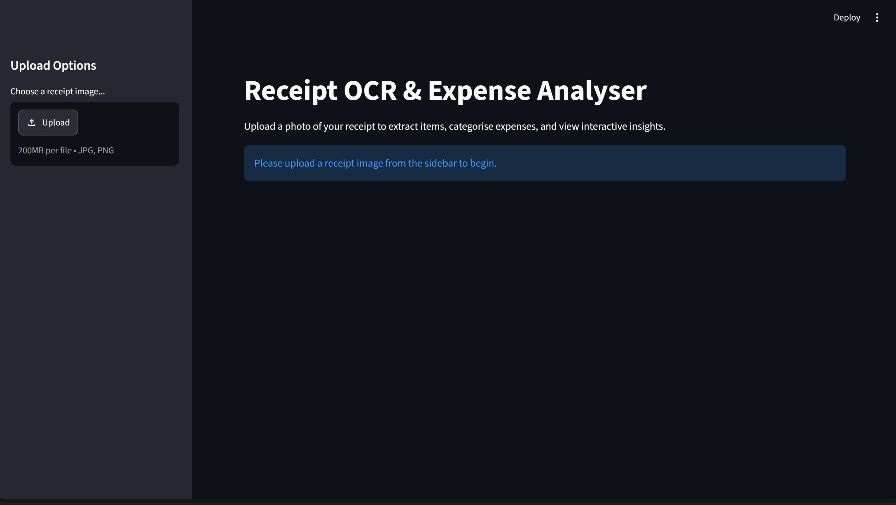
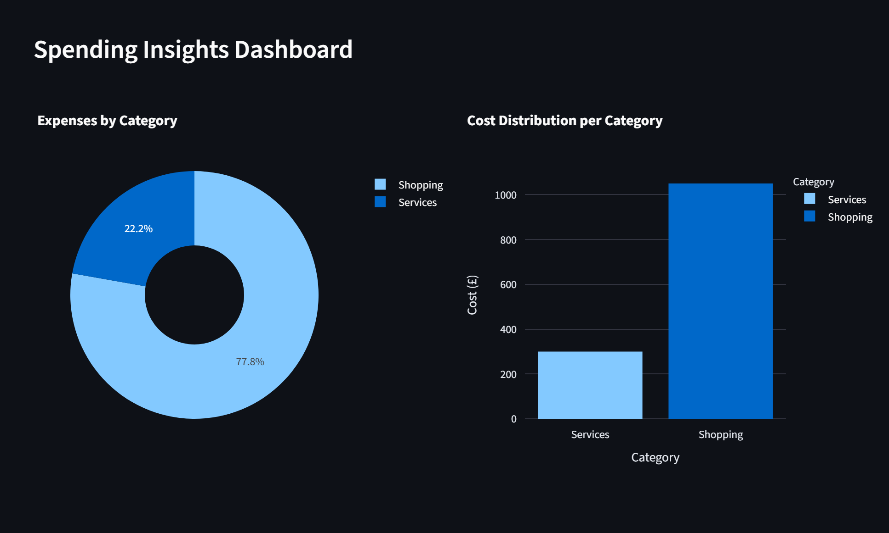

Receipt OCR & Expense Analyser

A Python application that transforms receipt images into structured expense data using OCR, with editable expense breakdowns, total validation and interactive spending insights.

## Overview

This project automates calculating and breaking down receipt expenses.

Built with Python, the application processes uploaded receipt images, extracts readable text using Tesseract OCR, organises recognised expense items into an editable table and visualises spending across categories.

## Features

* **Receipt image processing:** Upload JPG, JPEG and PNG receipts through a Streamlit interface.
* **Optical Character Recognition:** Use Tesseract OCR to extract text from receipt images.
* **Image preprocessing:** Apply OpenCV-based image processing to help prepare receipt images for text extraction.
* **Editable expense breakdown:** Review and modify extracted expense items, costs and categories.
* **Expense calculation:** Calculate the total of the analysed line items.
* **Receipt-total validation:** Compare the analysed total with the total identified on the receipt and flag discrepancies.
* **Interactive spending insights:** Explore expense distributions using Plotly charts, including category breakdowns and cost comparisons.
* **OCR debugging:** Inspect the preprocessed image and extracted text to help investigate recognition problems.

## Application Preview

### 1. Application Interface




### 2. Receipt Processing and Itemised Expenses


### 3. Spending Insights



## How It Works

1. **Upload:** The user selects a supported receipt image.
2. **Load and preprocess:** The image is loaded and processed before text extraction.
3. **Extract:** Tesseract OCR identifies text from the receipt.
4. **Structure:** The extracted text is parsed into expense items and a receipt total where recognisable.
5. **Review:** The user can edit the extracted costs and categories.
6. **Validate:** The application compares the sum of the analysed line items with the detected receipt total, when available.
7. **Visualise:** Plotly charts display the distribution of expenses across categories.

## Getting Started

### Prerequisites

* Python installed on your computer.
* Tesseract OCR installed and accessible to the application.
* The project dependencies listed in `requirements.txt`.

### Installation

Clone the repository:

```bash
git clone https://github.com/KaramNanneh/ReceiptExpenseAnanlyser.git
cd ReceiptExpenseAnanlyser
```

Install the Python dependencies:

```bash
pip install -r requirements.txt
```

Install Tesseract OCR separately if it is not already installed. Ensure that the executable is accessible to the application; on Windows, the current implementation checks the standard installation path.

### Run the Application

```bash
streamlit run app.py
```

Open the local URL displayed in the terminal by Streamlit.

## Considerations

Receipt OCR is not perfectly reliable: image quality, formatting differences and ambiguous characters can affect extraction accuracy.

This project addresses some of these challenges by including image preprocessing, an editable expense table, receipt-total comparison and an OCR debugging panel. These features make it possible to inspect extracted information and identify potential discrepancies rather than treating every OCR result as automatically correct.
